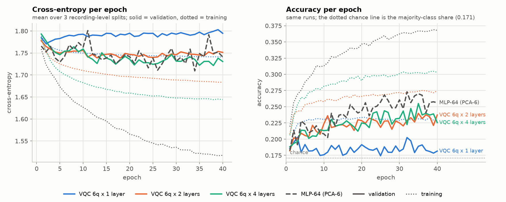
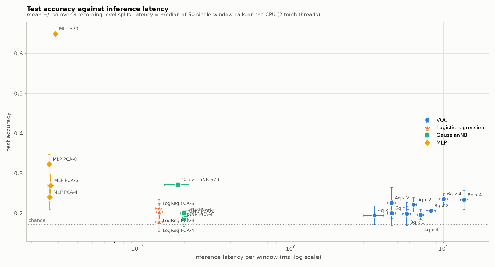
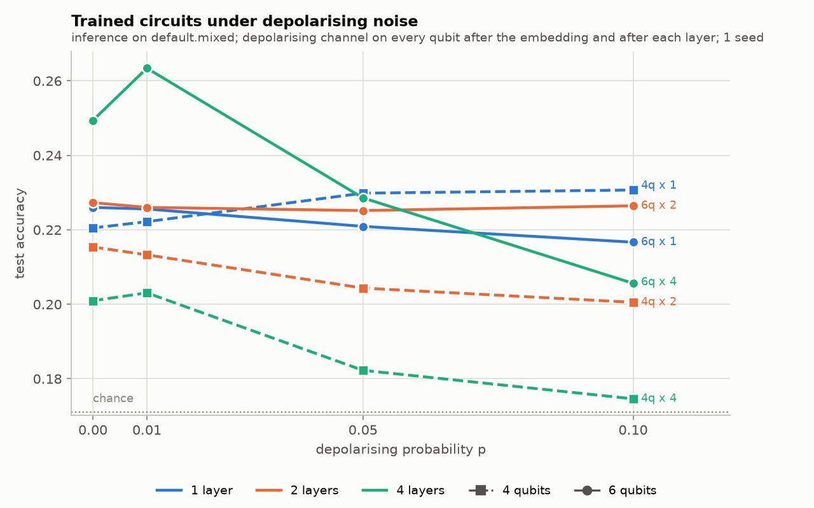

# Benchmark: variational quantum classifier against classical baselines on Avatar EEG windows

Deliverable of upstream issue Avanznow/Tellekynezix#52 (the benchmark step of the QML chain #49-#52). Every number below comes from a CSV in `results/` written by one command (`python -m prediction_quantum.run_benchmark --config configs/default.yaml`); see README.md for the environment. Generated 2026-10-17 21:39:56.

## Headline

- **Same data for every model.** 11,698 windows (1.024 s, 15 channels, 125 Hz) of 883 OpenBCI recordings from 18 participants, through the GaussianNB pipeline's verified loader and 570-feature extractor, split by recording (3 splits, seeds [0, 1, 2]). Chance (majority-class share) is 0.171.
- **Accuracy.** The best circuit by mean test accuracy is **VQC 6q x 4 layers**: 0.236 +/- 0.013 (macro-F1 0.229 +/- 0.011). On the identical 6-dimensional input, logistic regression reaches 0.212 +/- 0.022, GaussianNB 0.195 +/- 0.012 and the 64-unit MLP 0.270 +/- 0.029; the circuit is above logistic regression and below the MLP. The best classical model overall is MLP-64 (570 features) at 0.649 +/- 0.005.
- **Cost.** Training the best circuit took 220.8 s of optimiser time per seed against 3.6 s for the MLP and 0.13 s for logistic regression on the same input. One window takes 9.99 ms through the simulated circuit against 0.137 ms for logistic regression (73x) and 0.027 ms for the MLP. Training evaluated the circuit 374,200 times per seed (one run per window per forward pass, gradients by backprop on the simulator); the parameter-shift rule needed on hardware would have cost 47,337,667 runs before shots.
- **Noise.** With a depolarising channel on every qubit after the embedding and after each layer, the accuracy of the 6 swept circuits changes by between -0.044 and +0.010 at p = 0.1 (chance 0.171); the deepest circuits lose most (VQC 6q x 4 layers: 0.249 -> 0.206), shallow ones barely move because the channel contracts every expectation value towards zero while the linear head's decision depends mostly on their direction. At p = 0.1 the 1-layer circuits change 14%-23% of their predictions, the 4-layer circuits 76%-83%. Details in section 4.6.

**Reading.** The best circuit beats the linear model on its own 6-dimensional input by +0.024 accuracy, more than one standard deviation over seeds (0.022), and is below the 64-unit MLP on the same input (-0.034). Against the best classical model on the full 570 features it is 0.413 lower, and it is 73x slower per window than logistic regression and 373x slower than the MLP. So on this problem the circuit adds some capacity over a linear read-out of the same components, far less than a small classical network, at orders of magnitude more compute. The value of this benchmark is the fair, reproducible comparison and its documented limits (section 5).

## 1. Data and split

- **Source.** `Data_clean/` at the repository root (the OpenBCI recordings of the Avatar project), read with `prediction-gaussiannb/eeg_data.py` (`load_recordings`, board `16ch_125hz`, channel 15 excluded, the start-up and every failing 2 s block dropped by the deployed signal-quality policy, 1-40 Hz zero-phase band-pass and 60 Hz notch per kept segment).
- **Windows.** 128 samples (1.024 s) with stride 64 cut inside each kept segment, the PyTorch GaussianNB notebook's rule including the tail window; 12,089 windows from 883 recordings and 18 participants (432 files of the other board or unreadable were skipped by the loader).
- **Features.** `prediction-gaussiannb/improved_gnb_features.py::extract_features`: 570 per window = log-Euclidean covariance (120) + the same on the differenced signal (120) + Teager-Kaiser energy (30) + 10 log-scale statistics and relative band powers per channel (150) + the same on common-average-referenced channels (150).
- **Subsample.** At most 2000 windows per command, drawn once with seed 0 before splitting: 11,698 windows used (backward 1882, forward 1866, landing 2000, left 1987, right 1963, takeoff 2000).
- **Split.** By recording with `GroupShuffleSplit` (the protocol of the defense benchmark in `prediction-gaussiannb/defense/`): 20 % of the recordings are the test set and 10 % of the recordings are the validation set used only for per-epoch monitoring and checkpoint choice; one split per seed. The window indices of every part are in `results/split_seed<seed>.csv`, and every model (classical and quantum) reads them from there. Scaler, PCA and models are fitted on the training part only.

| seed | part | windows | recordings | participants | backward | forward | landing | left | right | takeoff |
|---|---|---|---|---|---|---|---|---|---|---|
| 0 | train | 8,173 | 617 | 18 | 1361 | 1338 | 1322 | 1408 | 1318 | 1426 |
| 0 | val | 1,171 | 89 | 17 | 172 | 187 | 235 | 201 | 215 | 161 |
| 0 | test | 2,354 | 177 | 18 | 349 | 341 | 443 | 378 | 430 | 413 |
| 1 | train | 8,146 | 617 | 18 | 1305 | 1285 | 1324 | 1496 | 1241 | 1495 |
| 1 | val | 1,207 | 89 | 16 | 115 | 174 | 250 | 161 | 297 | 210 |
| 1 | test | 2,345 | 177 | 18 | 462 | 407 | 426 | 330 | 425 | 295 |
| 2 | train | 8,166 | 617 | 18 | 1442 | 1227 | 1369 | 1332 | 1305 | 1491 |
| 2 | val | 1,202 | 89 | 17 | 142 | 226 | 189 | 168 | 272 | 205 |
| 2 | test | 2,330 | 177 | 17 | 298 | 413 | 442 | 487 | 386 | 304 |

Source: `results/dataset_splits.csv`, `results/dataset.json`.

## 2. Models

### 2.1 Encoding (classical pre-processing in front of the circuit)

Angle embedding needs one feature per qubit, so the 570 standardised features are projected to `n_qubits` principal components (StandardScaler + PCA, training windows only). Each component is mapped to an RY angle in [0, pi]: the training 1st and 99th percentiles of the component go to 0 and pi and values beyond them are clipped, so the embedding never wraps around. The classical PCA baselines receive exactly these angle vectors, so "same input" holds literally. Variance kept by the PCA:

| seed | qubits (components) | variance explained | per component |
|---|---|---|---|
| 0 | 4 | 0.335 | 0.152 0.087 0.054 0.042 |
| 0 | 6 | 0.402 | 0.152 0.087 0.054 0.042 0.037 0.029 |
| 0 | 8 | 0.450 | 0.152 0.087 0.054 0.042 0.037 0.029 0.024 0.024 |
| 1 | 4 | 0.336 | 0.148 0.089 0.055 0.044 |
| 1 | 6 | 0.397 | 0.148 0.089 0.055 0.044 0.033 0.029 |
| 1 | 8 | 0.444 | 0.148 0.089 0.055 0.044 0.033 0.029 0.024 0.023 |
| 2 | 4 | 0.320 | 0.128 0.090 0.056 0.045 |
| 2 | 6 | 0.384 | 0.128 0.090 0.056 0.045 0.035 0.029 |
| 2 | 8 | 0.434 | 0.128 0.090 0.056 0.045 0.035 0.029 0.025 0.024 |

Source: `results/encoders.csv`. Implementation: `prediction_quantum/encoding.py`.

### 2.2 Variational quantum classifier

`AngleEmbedding(RY)` on `n_qubits` wires -> `StronglyEntanglingLayers` with `n_layers` layers (3 rotation angles per qubit per layer, CNOT range (l mod (n-1)) + 1 in layer l) -> `expval(PauliZ)` on every qubit -> `nn.Linear(n_qubits, 6)` -> softmax cross-entropy. Grid: [4, 6, 8] qubits x [1, 2, 4] layers. Simulator `default.qubit` (state vector, PennyLane 0.45.1) with the torch interface, parameter broadcasting over the mini-batch and backprop differentiation. Weights are initialised uniformly in [0, 2 pi) (PennyLane's TorchLayer default) with the run's seed. Implementation: `prediction_quantum/vqc.py`.

### 2.3 Classical baselines

| model | input | implementation |
|---|---|---|
| Logistic regression (PCA-n) | the circuit's n angle vectors | sklearn `LogisticRegression` (multinomial, lbfgs, C = 1) - a linear model on the circuit's input, the fairest match |
| GaussianNB (PCA-n) | the same angle vectors | sklearn `GaussianNB` |
| MLP-64 (PCA-n) | the same angle vectors | torch `Linear(n, 64) -> ReLU -> Linear(64, 6)`, same loop, optimiser, epochs and batch size as the circuit |
| GaussianNB (570 features) | all 570 standardised features | sklearn `GaussianNB` - the project's GaussianNB decoder family on the full feature set |
| MLP-64 (570 features) | all 570 standardised features | the same torch MLP, as an unconstrained classical reference |

### 2.4 Training protocol (circuit and MLPs)

Adam (lr 0.01 for the circuit, 0.01 for the MLPs), cross-entropy, batch size 64, 40 epochs, data shuffled with the run's seed. Train and validation loss and accuracy are logged after every epoch (`results/runs/<run>/history.csv`); the parameters at the epoch with the best validation accuracy are kept (`params.pt`) and evaluated once on the test part. Each run directory holds a `config.yaml` from which `python -m prediction_quantum.runs <config.yaml>` re-trains that run alone. Implementation: `prediction_quantum/train.py`, `runs.py`.

## 3. Metric definitions

| metric | definition |
|---|---|
| accuracy | share of test windows whose predicted command is the true one (`sklearn.metrics.accuracy_score`) |
| macro-F1 | unweighted mean over the six commands of the per-command F1 (`f1_score(average="macro")`) |
| balanced accuracy | mean over the six commands of the per-command recall (`balanced_accuracy_score`) |
| train (s) | wall time of fitting: for torch models the forward, backward and optimiser steps over all epochs (validation passes excluded); for sklearn models `fit()` |
| latency (ms/window) | time to classify ONE window (batch of one) from its encoded input, median of 50 calls after 5 warm-up calls, 2 torch threads; the shared PCA encoding is timed separately (`encoder_latency_ms`) |
| batched (us/window) | time per window when the whole test part is classified in batches of 256 (parameter broadcasting on the simulator) |
| circuit evaluations | circuit runs counted by `qml.Tracker` on the device: one per window per forward pass (the hardware-equivalent count); `simulations` is the number of batched state-vector simulations actually performed |
| parameter-shift equivalent | runs a parameter-shift gradient would need on hardware: windows forwarded in training x (1 + 2 x trainable circuit parameters), before shots |
| parameters | trainable parameters incl. the classical head (GaussianNB: means, variances and priors) |

Mean +/- standard deviation over the seeds (one recording-level split and one initialisation per seed).

## 4. Results

### 4.1 All models

| model | input | parameters | accuracy | macro-F1 | balanced acc. | train (s) | latency (ms/window) | batched (us/window) | circuit evals (training) |
|---|---|---|---|---|---|---|---|---|---|
| VQC 4q x 1 layer | PCA-4 angles | 42 | 0.195 +/- 0.024 | 0.165 +/- 0.016 | 0.210 +/- 0.019 | 54.01 +/- 1.64 | 3.529 +/- 0.531 | 18.3 | 374,200 |
| VQC 4q x 2 layers | PCA-4 angles | 54 | 0.226 +/- 0.039 | 0.209 +/- 0.031 | 0.237 +/- 0.038 | 84.13 +/- 3.48 | 4.552 +/- 0.274 | 23.5 | 374,200 |
| VQC 4q x 4 layers | PCA-4 angles | 78 | 0.196 +/- 0.012 | 0.169 +/- 0.004 | 0.211 +/- 0.018 | 138.24 +/- 5.81 | 7.072 +/- 0.315 | 36.8 | 374,200 |
| VQC 6q x 1 layer | PCA-6 angles | 60 | 0.200 +/- 0.032 | 0.188 +/- 0.035 | 0.214 +/- 0.027 | 83.60 +/- 0.68 | 4.582 +/- 0.288 | 27.1 | 374,200 |
| VQC 6q x 2 layers | PCA-6 angles | 78 | 0.221 +/- 0.018 | 0.213 +/- 0.021 | 0.233 +/- 0.011 | 129.57 +/- 0.87 | 6.368 +/- 0.267 | 38.5 | 374,200 |
| VQC 6q x 4 layers | PCA-6 angles | 114 | 0.236 +/- 0.013 | 0.229 +/- 0.011 | 0.247 +/- 0.010 | 220.81 +/- 1.44 | 9.995 +/- 0.645 | 63.7 | 374,200 |
| VQC 8q x 1 layer | PCA-8 angles | 78 | 0.198 +/- 0.029 | 0.186 +/- 0.032 | 0.211 +/- 0.032 | 128.21 +/- 3.91 | 5.736 +/- 0.327 | 48.6 | 374,200 |
| VQC 8q x 2 layers | PCA-8 angles | 102 | 0.206 +/- 0.003 | 0.203 +/- 0.006 | 0.211 +/- 0.003 | 200.78 +/- 8.11 | 8.258 +/- 0.599 | 72.6 | 374,200 |
| VQC 8q x 4 layers | PCA-8 angles | 150 | 0.233 +/- 0.023 | 0.230 +/- 0.027 | 0.239 +/- 0.017 | 343.49 +/- 3.48 | 13.627 +/- 0.799 | 112.7 | 374,200 |
| Logistic regression (PCA-4) | PCA-4 angles | 30 | 0.178 +/- 0.024 | 0.156 +/- 0.027 | 0.189 +/- 0.025 | 0.07 +/- 0.01 | 0.137 +/- 0.007 | 0.1 | - |
| Logistic regression (PCA-6) | PCA-6 angles | 42 | 0.212 +/- 0.022 | 0.199 +/- 0.029 | 0.226 +/- 0.021 | 0.13 +/- 0.04 | 0.137 +/- 0.006 | 0.1 | - |
| Logistic regression (PCA-8) | PCA-8 angles | 54 | 0.203 +/- 0.022 | 0.194 +/- 0.028 | 0.215 +/- 0.022 | 0.16 +/- 0.05 | 0.138 +/- 0.006 | 0.1 | - |
| GaussianNB (PCA-4) | PCA-4 angles | 54 | 0.187 +/- 0.019 | 0.153 +/- 0.014 | 0.195 +/- 0.016 | 0.00 +/- 0.00 | 0.200 +/- 0.010 | 0.3 | - |
| GaussianNB (PCA-6) | PCA-6 angles | 78 | 0.195 +/- 0.012 | 0.187 +/- 0.014 | 0.202 +/- 0.018 | 0.00 +/- 0.00 | 0.205 +/- 0.009 | 0.4 | - |
| GaussianNB (PCA-8) | PCA-8 angles | 102 | 0.200 +/- 0.004 | 0.189 +/- 0.014 | 0.206 +/- 0.011 | 0.00 +/- 0.00 | 0.200 +/- 0.009 | 0.4 | - |
| GaussianNB (570 features) | 570 standardised features | 6,846 | 0.271 +/- 0.005 | 0.253 +/- 0.008 | 0.266 +/- 0.004 | 0.05 +/- 0.01 | 0.182 +/- 0.033 | 11.2 | - |
| MLP-64 (PCA-4) | PCA-4 angles | 710 | 0.240 +/- 0.032 | 0.228 +/- 0.032 | 0.251 +/- 0.031 | 2.86 +/- 0.32 | 0.027 +/- 0.001 | 0.2 | - |
| MLP-64 (PCA-6) | PCA-6 angles | 838 | 0.270 +/- 0.029 | 0.264 +/- 0.027 | 0.276 +/- 0.025 | 3.56 +/- 0.12 | 0.027 +/- 0.001 | 0.2 | - |
| MLP-64 (PCA-8) | PCA-8 angles | 966 | 0.322 +/- 0.024 | 0.319 +/- 0.027 | 0.324 +/- 0.024 | 2.71 +/- 0.10 | 0.026 +/- 0.000 | 0.2 | - |
| MLP-64 (570 features) | 570 standardised features | 36,934 | 0.649 +/- 0.005 | 0.647 +/- 0.005 | 0.651 +/- 0.005 | 4.33 +/- 0.10 | 0.029 +/- 0.000 | 1.6 | - |

Source: `results/benchmark_summary.csv` (per-run values in `benchmark_results.csv`). Chance = 0.171. PCA encoding of one window adds 0.174 ms (median over runs) in front of every PCA model.

Two context notes. The GaussianNB rows are plain sklearn `GaussianNB` on globally standardised features; the project's deployed GaussianNB decoder (`prediction-gaussiannb/`) adds per-participant normalisation and a fitted projection and reports about 0.49 window accuracy on recording-grouped folds of the same windows, so these rows are a baseline, not the deployed decoder. The MLP-64 on 570 features is in line with the defense benchmark's run of the project's original JAX MLP on the same windows under six recording-grouped hold-outs (0.702 +/- 0.030, `prediction-gaussiannb/defense/defense_tables.md`), which used 100 epochs and early stopping.

### 4.2 Circuit grid: qubits x depth

**accuracy**

|  | 1 layer | 2 layers | 4 layers |
|---|---|---|---|
| 4 qubits | 0.195 +/- 0.024 | 0.226 +/- 0.039 | 0.196 +/- 0.012 |
| 6 qubits | 0.200 +/- 0.032 | 0.221 +/- 0.018 | 0.236 +/- 0.013 |
| 8 qubits | 0.198 +/- 0.029 | 0.206 +/- 0.003 | 0.233 +/- 0.023 |

**macro-F1**

|  | 1 layer | 2 layers | 4 layers |
|---|---|---|---|
| 4 qubits | 0.165 +/- 0.016 | 0.209 +/- 0.031 | 0.169 +/- 0.004 |
| 6 qubits | 0.188 +/- 0.035 | 0.213 +/- 0.021 | 0.229 +/- 0.011 |
| 8 qubits | 0.186 +/- 0.032 | 0.203 +/- 0.006 | 0.230 +/- 0.027 |

**train (s)**

|  | 1 layer | 2 layers | 4 layers |
|---|---|---|---|
| 4 qubits | 54.01 +/- 1.64 | 84.13 +/- 3.48 | 138.24 +/- 5.81 |
| 6 qubits | 83.60 +/- 0.68 | 129.57 +/- 0.87 | 220.81 +/- 1.44 |
| 8 qubits | 128.21 +/- 3.91 | 200.78 +/- 8.11 | 343.49 +/- 3.48 |

**latency (ms/window)**

|  | 1 layer | 2 layers | 4 layers |
|---|---|---|---|
| 4 qubits | 3.53 +/- 0.53 | 4.55 +/- 0.27 | 7.07 +/- 0.32 |
| 6 qubits | 4.58 +/- 0.29 | 6.37 +/- 0.27 | 9.99 +/- 0.65 |
| 8 qubits | 5.74 +/- 0.33 | 8.26 +/- 0.60 | 13.63 +/- 0.80 |

Source: `results/benchmark_summary.csv`.

### 4.3 Convergence



| run (mean over seeds) | val loss ep. 1 | val loss last | val acc ep. 1 | best val acc | best epoch | s / epoch |
|---|---|---|---|---|---|---|
| VQC 6q x 1 layer | 1.785 | 1.795 | 0.185 | 0.203 | 23.7 | 2.1 |
| VQC 6q x 2 layers | 1.778 | 1.751 | 0.182 | 0.240 | 18.0 | 3.2 |
| VQC 6q x 4 layers | 1.793 | 1.731 | 0.188 | 0.255 | 31.3 | 5.5 |
| MLP-64 (PCA-6) | 1.766 | 1.741 | 0.182 | 0.273 | 31.7 | 0.09 |

The figure shows the 6-qubit circuits at every depth and the MLP on the same input (mean over seeds; dotted = training, solid = validation). Source: `results/convergence.csv`.

### 4.4 Accuracy against inference latency



Every model on one figure: x = median single-window inference latency on the CPU (log scale), y = test accuracy, bars = standard deviation over seeds. Circuits (blue) sit far to the right of the classical models at the same or lower accuracy; the batched throughput (table 4.1) narrows the gap on the simulator because the state-vector simulation is broadcast over the batch, which has no hardware analogue.

### 4.5 Circuit evaluations

| circuit | circuit params | evaluations in training (incl. validation passes) | batched simulations in training | parameter-shift equivalent (training part) | evaluations on the test part | batched simulations on the test part |
|---|---|---|---|---|---|---|
| VQC 4q x 1 layer | 12 | 374,200 | 5,240 | 8,161,667 | 2,343 | 10 |
| VQC 4q x 2 layers | 24 | 374,200 | 5,240 | 15,996,867 | 2,343 | 10 |
| VQC 4q x 4 layers | 48 | 374,200 | 5,240 | 31,667,267 | 2,343 | 10 |
| VQC 6q x 1 layer | 18 | 374,200 | 5,240 | 12,079,267 | 2,343 | 10 |
| VQC 6q x 2 layers | 36 | 374,200 | 5,240 | 23,832,067 | 2,343 | 10 |
| VQC 6q x 4 layers | 72 | 374,200 | 5,240 | 47,337,667 | 2,343 | 10 |
| VQC 8q x 1 layer | 24 | 374,200 | 5,240 | 15,996,867 | 2,343 | 10 |
| VQC 8q x 2 layers | 48 | 374,200 | 5,240 | 31,667,267 | 2,343 | 10 |
| VQC 8q x 4 layers | 96 | 374,200 | 5,240 | 63,008,067 | 2,343 | 10 |

Means over seeds. One evaluation = one circuit run for one window at one parameter setting (what `qml.Tracker` counts as an execution). Training forwards every training window once per epoch (40 epochs) plus the validation part once per epoch. On the simulator, gradients come from backprop at no extra circuit runs; on hardware each gradient step would need the parameter-shift column, and every expectation value would additionally need of the order of 1000 shots.

### 4.6 Sensitivity to simulated depolarising noise



| circuit | p = 0.0 | p = 0.01 | p = 0.05 | p = 0.1 |
|---|---|---|---|---|
| VQC 4q x 1 layer | 0.220 | 0.222 | 0.230 | 0.231 |
| VQC 4q x 2 layers | 0.215 | 0.213 | 0.204 | 0.201 |
| VQC 4q x 4 layers | 0.201 | 0.203 | 0.182 | 0.175 |
| VQC 6q x 1 layer | 0.226 | 0.226 | 0.221 | 0.217 |
| VQC 6q x 2 layers | 0.227 | 0.226 | 0.225 | 0.226 |
| VQC 6q x 4 layers | 0.249 | 0.263 | 0.229 | 0.206 |

Accuracy on the test part (seed [0]) when the trained parameters are run on `default.mixed` with `qml.DepolarizingChannel(p)` on every qubit after the embedding and after each entangling layer (n_layers + 1 noise layers), inference only. The p = 0 column reproduces the noiseless accuracy of the same run. Circuits with more than 6 qubits were not swept because density-matrix simulation scales as 4^n. Macro-F1 and balanced accuracy per p are in `results/noise_sweep.csv`.

**What the noise does to the read-out** (mean |<Z>| over the test windows / share of windows whose predicted command changed from p = 0):

| circuit | p = 0.0 | p = 0.01 | p = 0.05 | p = 0.1 |
|---|---|---|---|---|
| VQC 4q x 1 layer | 0.246 / 0% | 0.235 / 1% | 0.192 / 7% | 0.147 / 14% |
| VQC 4q x 2 layers | 0.102 / 0% | 0.095 / 3% | 0.069 / 23% | 0.046 / 53% |
| VQC 4q x 4 layers | 0.194 / 0% | 0.166 / 16% | 0.089 / 65% | 0.040 / 76% |
| VQC 6q x 1 layer | 0.144 / 0% | 0.137 / 2% | 0.111 / 11% | 0.084 / 23% |
| VQC 6q x 2 layers | 0.112 / 0% | 0.103 / 3% | 0.074 / 15% | 0.047 / 35% |
| VQC 6q x 4 layers | 0.065 / 0% | 0.052 / 18% | 0.022 / 63% | 0.007 / 83% |

A depolarising channel shrinks a qubit's Bloch vector by 1 - 4p/3 per application, so every expectation value is pulled towards zero: for the VQC 6q x 2 layers circuit the mean |<Z>| goes from 0.112 at p = 0 to 0.047 at p = 0.1 (a factor 0.42), while 35% of its test windows change command. The linear head's argmax depends mostly on the direction of the expectation vector, so a shallow circuit keeps most of its (low) accuracy until the contraction lets the head's bias terms dominate; circuits with more layers pass through more noise layers and lose more (VQC 6q x 4 layers: 0.249 -> 0.206). Small increases at low p are within the run-to-run spread of the noiseless accuracy and not a noise benefit. Source: `results/noise_sweep.csv`.

## 5. Limitations

- **Simulator only.** Every circuit ran on PennyLane's CPU state-vector (`default.qubit`) or density-matrix (`default.mixed`) simulator. No hardware run; the latency, circuit-evaluation and noise numbers describe the simulation, not a device. On hardware every expectation value needs shots (not modelled), gradients need parameter-shift evaluations (only counted, section 4.5) and noise is not a uniform depolarising channel.
- **Subsampled, within-participant data.** At most 2000 windows per command were used, and the split is by recording, not by participant: as the GaussianNB notebooks document, held-out participants are at chance on this dataset, so these accuracies measure within-participant separability. Overlapping windows (stride 64 of 128) of one recording are always in the same part.
- **PCA reduction.** The circuit sees [4, 6, 8] principal components of 570 features (4: 34%, 6: 40%, 8: 45% of the variance, seed 0). The 570-feature baselines show what that reduction costs; a different encoding (amplitude encoding, data re-uploading, more qubits) could move the circuit's numbers.
- **Few seeds.** 3 seeds ([0, 1, 2]), each with its own recording-level split and initialisation; the noise sweep used seed [0] only. The standard deviations are over seeds and conflate split and initialisation variance.
- **One optimiser setting.** Adam at lr 0.01 (circuit) / 0.01 (MLP), batch 64, 40 epochs, best-validation checkpoint; no hyper-parameter search for any model, so no model is tuned.
- **Depth and width grid.** Only StronglyEntanglingLayers with 1, 2 and 4 layers on 4, 6 and 8 qubits; no other ansatz, no re-uploading, no trainable encoding.
- **Latency is CPU wall time** of a Python call on this machine (table in section 6) and depends on thread count and load; the ratios between models are more robust than the absolute values.

## 6. Reproduction and environment

```bash
cd prediction-quantum
python -m prediction_quantum.run_benchmark --config configs/default.yaml --data-dir ../Data_clean
```

The command rebuilds the feature cache from `Data_clean` when missing, writes every CSV, figure and this report, and skips finished runs (`--force` redoes them; `--quick` is a few-minute smoke version). Compute time of the run that produced this report: 0 min in total (features and splits 0 s, training 0.0 min with 2 parallel processes, latency 0 s, noise sweep 0.0 min). Source: `results/timing.json`.

| environment |  |
|---|---|
| python | 3.12.3 |
| torch | 2.12.1+cu130 |
| pennylane | 0.45.1 |
| numpy | 2.5.0 |
| scipy | 1.18.0 |
| scikit_learn | 1.9.0 |
| pandas | 3.0.3 |
| cpu | 11th Gen Intel(R) Core(TM) i7-11800H @ 2.30GHz |
| logical_cpus | 16 |
| torch_threads | 2 |
| n_jobs | 2 |
| platform | Linux-7.1.5-76070105-generic-x86_64-with-glibc2.39 |
| generated | 2026-10-17 21:39:56 |

Source: `results/environment.json`. Tests: `pytest tests/`.

## Files

| file | content |
|---|---|
| `results/benchmark_summary.csv` | one row per model: mean and sd of every metric over seeds |
| `results/benchmark_results.csv` | one row per run (model x seed) |
| `results/convergence.csv` | per-epoch train / validation loss and accuracy of every torch run |
| `results/noise_sweep.csv` | accuracy, macro-F1, balanced accuracy of every swept circuit at every p |
| `results/split_seed<k>.csv`, `dataset_splits.csv`, `dataset.json` | the exact windows of every part, counts, loader statistics |
| `results/encoders.csv`, `encoders/` | PCA variance per encoder; the fitted encoders (joblib) |
| `results/runs/<run>/` | `config.yaml`, `metrics.json`, `history.csv`, `params.pt` or `model.joblib`, `test_predictions.npy` |
| `results/fig_*.png` | the three figures |
| `results/environment.json`, `timing.json`, `config_used.yaml` | versions, machine, phase timings, the resolved config |
